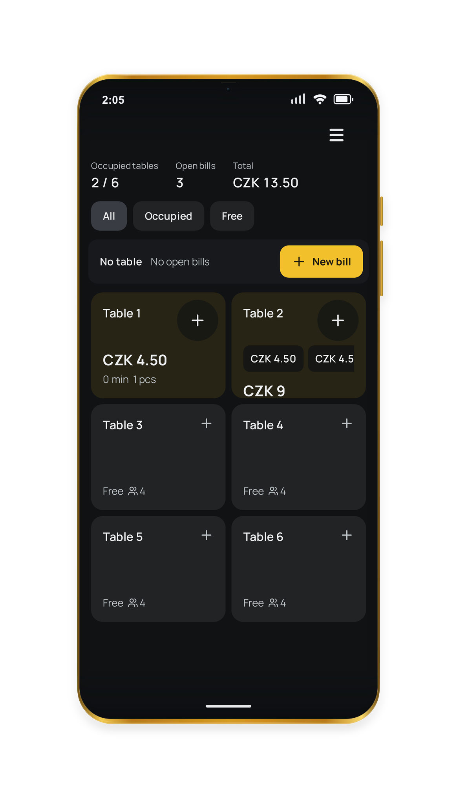
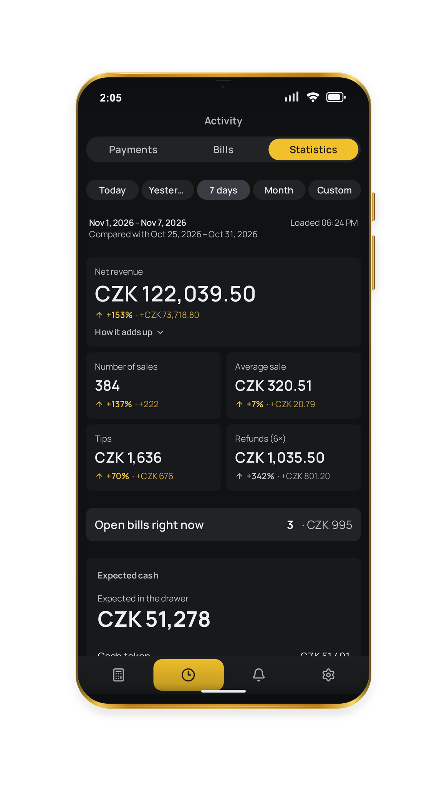

# Finito

Finito turns a phone into a payment terminal for small merchants, events,
pop-ups and restaurants. It combines Czech and Slovak bank transfer QR
payments, cash and Bitcoin (Lightning, Spark, Cashu) in one local-first app:
the customer scans a code and pays straight into the merchant's account, with
no fees, no contract and no extra hardware.

<p>
  
  
  
</p>

- **Payments**: bank transfer QR codes (CZ and SK), cash, Bitcoin, card
  terminals, tips, refunds and Czech EET reporting.
- **Bills and tables**: a catalog of items, open bills seated at tables,
  bills split between guests.
- **Activity and statistics**: the history of payments and bills, sales,
  payment methods and expected cash.
- **Local-first**: data lives on the device and syncs between devices
  through [Evolu](https://www.evolu.dev), end-to-end encrypted, backed up
  with one recovery phrase.

Finito runs on Android and as a PWA at [app.finito.fit](https://app.finito.fit).
Download the APK from the
[latest release](https://github.com/finitoapp/finito/releases/latest/download/finito-release-signed.apk)
or read more at [finito.fit](https://finito.fit).

## Requirements

- Bun, for dependencies and scripts. Versions are pinned: keep `exact = true`
  in `bunfig.toml`.
- Node 22.13+ for the Expo tooling.
- Android Studio with an Android SDK and an emulator or a device.

```bash
bun install
bunx skills experimental_install  # the locked agent skills from skills-lock.json
```

Keep local `.env` files at the repository root (`apps/web-app/.env.example`
is the template).

## Development

Finito is the Expo + React Native + Tamagui app in `apps/native-app`. From
the repository root:

```bash
bun run native:android  # build and install a development client on Android
bun run dev:native      # start Metro for an installed development client
bun run native:web      # run the PWA in the browser
```

`native:android` generates the Android project locally (`apps/native-app/android`
is not committed) and installs it as `fit.finito.app.dev`, beside a released
Finito. After adding or upgrading a native module, run it again; restarting
Metro is not enough. The root native commands build `packages/core` first.

```bash
bun run build:native:web  # the PWA export deployed to app.finito.fit
bun run build:native      # the Android and iOS bundles into apps/native-app/dist
bun run check:native      # native TypeScript, also part of bun run check
```

Releases, the Android build and the deployments are described in
[releases](docs/releases.md) and [Finito deployment](docs/finito-deployment.md).

## End-to-end tests and screenshots

The Maestro flows in `apps/native-app/e2e` run against the PWA or an Android
emulator, both over a local mock server (`apps/native-app/e2e/AGENTS.md`):

```bash
bun run test:e2e:native:web
bun run test:e2e:native:android
```

Playwright drives the same PWA for the store and documentation images:

```bash
bun run docs:screenshots:native  # apps/native-app/docs: screenshots and mockups
bun run google-play:assets       # the Google Play listing, into apps/native-app/.tmp/google-play
```

## Workspaces

- `apps/native-app`: Finito, its PWA export and the API handlers it deploys.
- `packages/core`: the single domain implementation both apps share, imported
  through explicit subpaths such as `@payky/core/modules/payment/payment-actions`.
- `packages/app-shared`: the brands and the English, Czech and Slovak
  translations both apps use.
- `apps/landing`: the marketing site, built as finito.fit
  (`PAYKY_LANDING_BRAND=finito`, see [landing deployment](docs/landing-deployment.md)).
- `apps/cli`: local commands over the same data.
- `packages/doc-mockups`: the phone frame and the shared composition of the
  screenshots.

The repository also holds Payky, the same app under another brand over one
account (`docs/decisions/brand/`): the React web app in `apps/web-app`, which
also owns the API, and its Capacitor shell in `apps/native-shell`. Finito's
screens mirror Payky's; `apps/native-app/src/ui-parity` checks they do not
drift.

`AGENTS.md` describes the structure and the rules of the codebase in detail,
`docs/glossary.md` the domain words, and `docs/decisions` the business
decisions and the tests that hold them.

## Project Layout

- `apps/native-app/app` contains the expo-router routes.
- `apps/native-app/src/features` contains the screens, one folder per feature.
- `apps/native-app/src/components/ui` contains Finito's own UI kit on Tamagui.
- `apps/native-app/src/theme` contains the palette and themes.
- `apps/native-app/modules` contains the local Expo modules (card terminal,
  NFC, the account request to Payky).
- `packages/core/src/evolu` creates the Evolu client and composes the
  application schema.
- `packages/core/src/modules` contains the domain modules: accounts, catalog
  items, bills, payments, tables, settings, devices and the rest.
- `packages/core/src/integrations` contains one folder per external service
  (banks, EET, Lightning, Qerko, ...).
- `bin` contains repository checks and release scripts.

## Checks

Run the full validation suite:

```bash
bun run check
```

Run checks individually:

```bash
bun run check:lint
bun run check:ts
bun run check:decisions
bun run check:tests
bun run check:coverage
```

`check:decisions` verifies that every business decision in `docs/decisions`
names the tests that hold it. End-to-end tests are not part of `check`.

Format files with Biome:

```bash
bun run format
```

Run Vitest in watch mode:

```bash
bun run test:watch
```

## Data Model

Persistent application data is stored through Evolu. Register new tables and
indexes in `packages/core/src/evolu/schema.ts`, and keep domain code in the owning module
under `packages/core/src/modules`.

Domain modules generally use this structure:

- `*-types.ts` for branded ids, enums, unions, and exported domain types.
- Module root files, such as `payment.ts`, for Evolu table schemas and row
  exports.
- `*-actions.ts` for Evolu mutations and command-style operations.
- `*-queries.ts` for reusable Evolu queries and read models.
- `*-utils.ts` for pure helpers.
- `*.test.ts` beside the module it covers.

## Account Seed and Key Derivation

Each device account has a 128-bit master secret `S` (the `MasterKey`). For a
path `P`, derive a child key and independent 32-byte entropy:

```text
R = BIP32.MasterKey(S)
K = BIP32.Derive(R, P)
E = HMAC-SHA512(
  key = "bip-entropy-from-k",
  message = K.privateKey
)[0:32]
```

The paths follow [BIP-85](https://github.com/bitcoin/bips/blob/master/bip-0085.mediawiki)
with the BIP-39 application: `m/83696968'/39'/{language}'/{words}'/{index}'`,
language `0'` = English. The word count encodes how much of `E` the consumer
uses (24 words = 32 bytes, 12 words = 16 bytes). The paths must never change
after accounts exist.

| Consumer | Path `P` | Result |
| --- | --- | --- |
| Cashu wallet seed (shared with Linky) | `m/83696968'/39'/0'/24'/0'` | `E` → 24-word BIP-39 → `mnemonicToSeed(m, "")`, the 64-byte NUT-13 seed |
| Evolu master owner | `m/83696968'/39'/0'/24'/1'` | `E` as the 32-byte Evolu owner secret |
| Default Spark wallet | `m/83696968'/39'/0'/12'/0'` | `E[0:16]` as the 16-byte Spark wallet secret |
| Linky app (meta) owner | `m/83696968'/39'/0'/24'/1'/0'` | `E[0:16]` → 12-word BIP-39 → Evolu `mnemonicToOwnerSecret`; its `cashu` shard owners hold the shared Cashu wallet |

The Spark wallet secret is stored as hex and used as BIP-39 entropy: wallet
initialization and the settings UI encode it as a 12-word mnemonic (never the
raw secret), so the wallet can also be restored in any BIP-39-compatible Spark
client. The Cashu seed and the Linky owner are Linky's own derivations
(`packages/identity/src/derivationPaths.ts` there), so a master key moved
between the two apps opens the same Cashu wallet; the cross-app vectors in
`key-derivation-cross-app.test.ts` pin them.

Table self-pay keys come from `S` outside BIP-85, through HKDF-SHA256 with a
label as `info` (`packages/core/src/modules/shared/key-derivation.ts`). The self-pay
root uses `payky/table-self-pay/v1`. From the root, each table's secret uses
`table:<tableId>:<epoch>` and the Lightning rate key `rate`. From a table's
secret, its signing and view keys use `sign` and `view`. Background jobs hold
only the root (`docs/decisions/table-self-pay/0009`). The labels must never
change, since printed stickers carry keys derived from them.

`S` itself is backed up as a single [SLIP-39](https://github.com/satoshilabs/slips/blob/master/slip-0039.md)
20-word recovery mnemonic (`packages/core/src/modules/shared/key-derivation.ts`, via
the `slip39-ts` library), encoded as one group with a 1-of-1 threshold — there
is currently no multi-share Shamir splitting, so the phrase is the sole backup
of `S` and must be treated with the same care as a BIP-39 seed phrase. SLIP-39
mnemonics use their own wordlist and checksum and are not interchangeable with
BIP-39 mnemonics. The mnemonic's identifier (SLIP-39's 15-bit metadata field)
is derived deterministically from `S` via HMAC-SHA512 rather than randomized,
so encoding the same `S` always produces the same recovery phrase. 256-bit
master keys and their 33-word recovery mnemonics are not supported.

## CLI

The CLI reads `.env` files automatically. Environment variables are validated at
startup with `@t3-oss/env-core` and Zod.

```bash
PAYKY_DATA_DIR=./.data bun run cli payments list
bun --env-file=.env.cli apps/cli/src/cli.ts accounts list
```

Supported variables:

- `PAYKY_DATA_DIR`: the directory of the CLI's database, `payky.db`, on Evolu's own SQLite
  (`@evolu/nodejs`, prebuilt for macOS and Linux). Defaults to `.data` at the repository root,
  or `.data/<ownerId>` there with `PAYKY_RECOVERY_MNEMONIC`.
  An explicit relative path is resolved against the caller's working directory.
- `PAYKY_AI_BASE_URL`: OpenAI-compatible endpoint. Defaults to Payky's AI
  proxy, `https://payky.me/api/ai/v1`, which holds the provider and its key
  and takes the account's owner id as its key (`docs/decisions/ai/0001`).
  Point it at a local Ollama, `http://localhost:11434/v1`, to develop
  without it.
- `PAYKY_AI_MODEL`: model name for an endpoint other than the proxy, which
  picks its own; it must support tool calling.
- `PAYKY_RECOVERY_MNEMONIC`: an account's 20-word recovery phrase. The CLI then
  opens that account and runs as a device of it
  ([`docs/cli.md`](docs/cli.md)).
- `PAYKY_SELF_PAY_RELAYS`: the relays the account's self-pay relay list starts
  from ([`docs/cli.md`](docs/cli.md)).
- `PAYKY_QERKO_POS_ID`: the `Pos-Id` header of the Qerko card terminal API
  ([`docs/cli.md`](docs/cli.md)).
- `PAYKY_EET_PRODUCTION_URL`: EET's production endpoint, without which the CLI
  reports nothing to EET ([`docs/cli.md`](docs/cli.md)).

`bun run cli` replaces `bun bin/cli.ts`. The launcher preserves the caller's
working directory. `payky ai` is a prototype assistant: it reads
the local data, and the docs and source code git tracks. It never writes.

```bash
bun run cli ai "Which bills are still open?"
PAYKY_AI_BASE_URL=http://localhost:11434/v1 PAYKY_AI_MODEL=qwen3 \
  bun run cli ai "How does bill coverage work?"
```

## Internationalization

All user-facing text goes through `t(key)`. The translations live in
`packages/app-shared/src/i18n`: add each key to the group file its namespace
belongs to, `en/<group>.ts`, then the same file under `cs/` and `sk/`, and use
stable, feature-scoped names such as `bill.save`, `catalog.items.title` or
`activity.empty`. `bun run check:ts` fails while a key is missing from any
language. Name the app only through the `{appName}` placeholders, never
"Finito" or "Payky".
